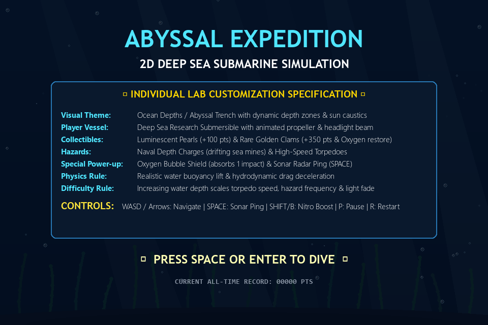
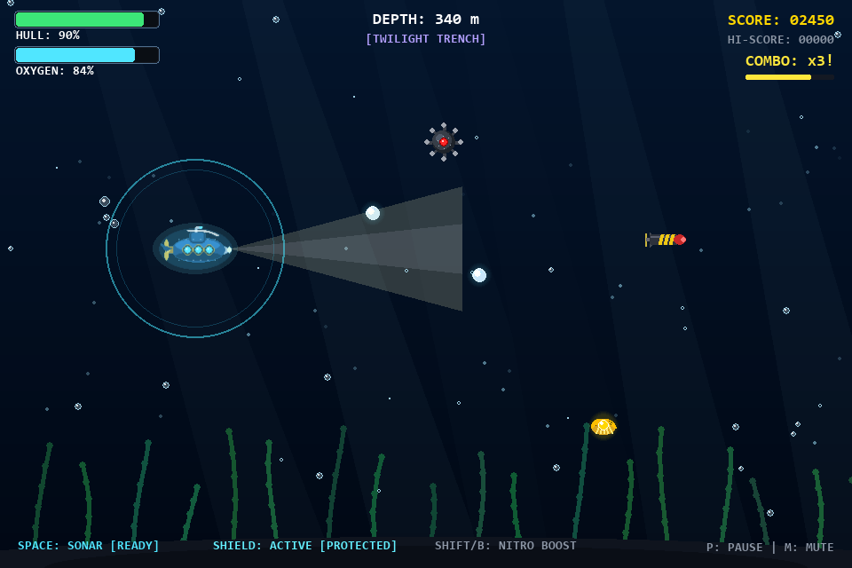
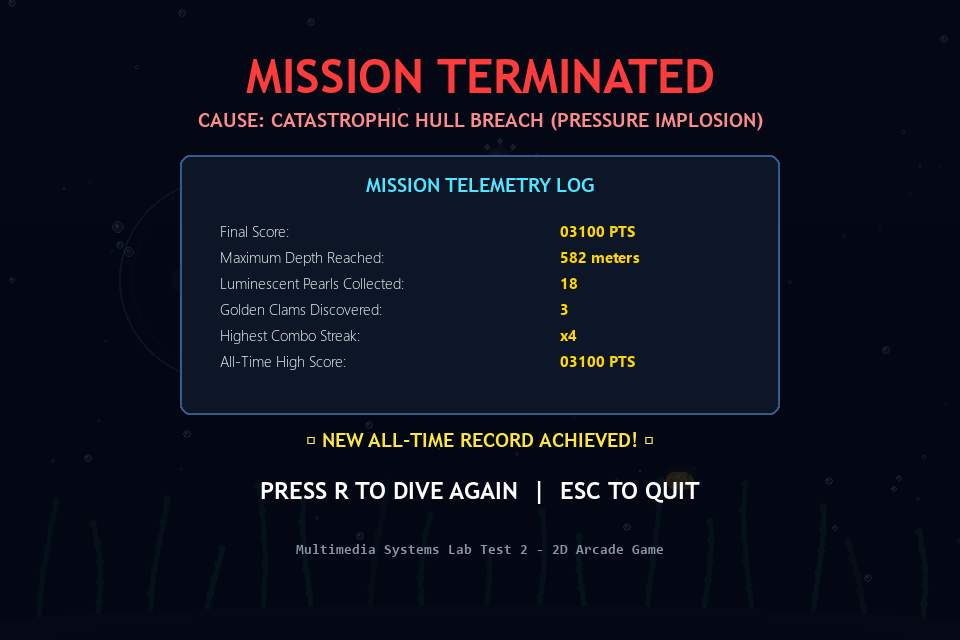

# Multimedia Systems Lab — Lab Test 2
## Customizable 2D Arcade Game: *Abyssal Expedition (Deep Sea Submarine)*

---

## 1. Project Overview

**Abyssal Expedition** is a feature-rich, customizable 2D arcade game built in Python using **Pygame**. The game demonstrates the core principles of multimedia systems engineering, including:
- Dynamic 2D raster and procedural sprite graphics with per-pixel alpha transparency.
- Procedural multi-track audio synthesis and real-time sound event handling.
- Continuous 60 FPS animation, particle systems, and volumetric lighting.
- Hydrodynamic physics simulation (water drag, inertia, and buoyancy lift).
- Rigorous circle-circle collision detection algorithms.
- Complete state machine architecture (Start, Gameplay, Paused, Game Over) with seamless in-app restarting.

---

## 2. Individual Customization Specification

As assigned for Lab Test 2, this project implements the **Deep Sea Submarine** customization:

| Feature Dimension | Assigned Customization Implementation |
| :--- | :--- |
| **Visual Theme & Setting** | **Ocean Depths & Abyssal Trench**: Multi-layer parallax background transitioning across three depth zones (Sunlight Shallows, Twilight Trench, Midnight Abyss) with shimmering sun ray caustics and swaying kelp forests. |
| **Player Character** | **Research Submersible ("Nautilus-II")**: Features animated pitch tilting on vertical ascent/descent, spinning stern propeller, illuminated brass portholes, and a volumetric forward headlight beam. |
| **Collectible Items** | **Luminescent Pearl Orbs** (+100 pts $\times$ Combo Multiplier) and **Golden Clam Shells** (+350 pts and +25% Life-Support Oxygen replenishment). |
| **Hazardous Obstacles** | **Naval Depth Charges** (drifting spiked sea mines with proximity flashing LEDs) and **High-Speed Torpedoes** (fast horizontal rockets with cavitation wake bubbles preceded by warning alert indicators). |
| **Special Power-Up / Object** | **Oxygen Bubble Shield**: An iridescent protective energy sphere enclosing the submarine that absorbs and deflects a lethal hazard hit, emitting a resonant acoustic shockwave. |
| **Special Ability** | **Sonar Radar Ping (`SPACE`)**: Sends an expanding echolocation wavefront that scans the deep water and magnetically pulls nearby pearl collectibles toward the submarine. |
| **Scoring / Penalty Mechanism** | **Depth Progression + Combo Multiplier**: Scoring scales with depth descent rate and rapid collectible pick chains (up to 4x). Collisions cause hull integrity loss (-35% / -45%), screen shake, red damage flash, and reset the combo meter. |
| **Difficulty Progression** | **Dynamic Water Pressure & Light Fade**: As depth increases from 0m to 1000m+, torpedo speeds increase by 25%, mine drop frequencies scale up by 2.5x, and ambient water darkens into pitch-black abyss where headlight navigation is critical. |
| **Physics Rule** | **Buoyancy & Hydrodynamic Drag**: Submarine experiences continuous upward water buoyancy and fluid friction damping, requiring steady manual navigation. |

---

## 3. Game Interface & Visual Screenshots

### A. Title & Customization Screen
Displays mission objectives, student lab customization specifications, controls summary, and all-time record.


---

### B. Active Gameplay Screen
Shows active submarine navigation, volumetric headlight beam cone, bubble trails, active oxygen bubble shield, pearl collectibles, drifting naval depth charge with proximity LED, incoming torpedo, and swaying kelp seabed.


---

### C. Mission Debriefing / Game Over Screen
Displays exact telemetry log, cause of mission termination (Hull Implosion vs. Oxygen Depletion), final score, depth reached, pearls/clams collected, combo streak, and quick restart prompt (`Press R to dive again`).


---

## 4. Gameplay Rules & Scoring Matrix

### Objectives
1. Steer the submarine deeper into the ocean trench to earn passive depth exploration points.
2. Collect **Luminescent Pearls** to build your **Combo Multiplier** (up to 4x).
3. Salvage rare **Golden Clams** from the ocean floor to replenish depleting **Life-Support Oxygen**.
4. Avoid or shield against **Naval Depth Charges** and **High-Speed Torpedoes**.
5. Survive as long as possible before Hull Integrity or Oxygen reaches 0%.

### Telemetry & Scoring Table

| Item / Action | Point Value | Special Gameplay Effect |
| :--- | :--- | :--- |
| **Luminescent Pearl** | $+100 \times \text{Combo}$ | Increases combo streak, resets combo countdown timer |
| **Golden Clam** | $+350 \times \text{Combo}$ | Restores $+25\%$ Oxygen meter |
| **Shield Capsule** | $+200$ | Equips protective Oxygen Bubble Shield |
| **Depth Descent** | $+1$ pt per 5m | Continuous passive score based on vertical descent rate |
| **Depth Charge Collision** | $-35\%$ Hull | Screen shake, red flash, resets combo to 1x |
| **Torpedo Collision** | $-45\%$ Hull | Heavy screen shake, red flash, resets combo to 1x |
| **Nitro Boost (`SHIFT`)** | Cost: $5\%$ Oxy/s | Increases submarine velocity by $1.5\times$ with dense bubble wake |

---

## 5. Controls & User Interaction

| Key Binding | Function |
| :--- | :--- |
| `W` / `Up Arrow` | Propel Submarine Upward (dive climb) |
| `S` / `Down Arrow` | Propel Submarine Downward (dive descent against buoyancy) |
| `A` / `Left Arrow` | Reverse / Decelerate Submarine |
| `D` / `Right Arrow` | Forward Thrusters |
| `SPACE` | **Sonar Radar Ping** (scans hazards & magnetizes pearls) |
| `LEFT SHIFT` / `B` | **Nitro Propeller Boost** (burst speed, emits heavy wake) |
| `P` or `ESC` | Pause / Resume Expedition |
| `R` | **Immediate In-App Restart** (playable at any state) |
| `M` | Toggle Audio Mute (ON / OFF) |
| `F12` | Instant High-Resolution PNG Screenshot capture |

---

## 6. Algorithm & Collision Detection Logic

### 6.1 Circle-Circle Euclidean Collision Detection
Because standard rectangular bounding boxes (AABBs) cause inaccurate "phantom" collisions on circular mines, round pearls, and sleek submarine hulls, this game utilizes **Euclidean Circle-Circle Collision Detection**:

Given Entity 1 with center $(x_1, y_1)$ and radius $r_1$, and Entity 2 with center $(x_2, y_2)$ and radius $r_2$:

1. Compute coordinate differences:
   $$\Delta x = x_2 - x_1, \quad \Delta y = y_2 - y_1$$
2. Compute Euclidean distance squared:
   $$d^2 = (\Delta x)^2 + (\Delta y)^2$$
3. Compare against the square of the sum of their radii:
   $$d^2 \le (r_1 + r_2)^2$$

```python
def check_circle_collision(c1, c2):
    x1, y1, r1 = c1
    x2, y2, r2 = c2
    dx = x2 - x1
    dy = y2 - y1
    dist_sq = dx * dx + dy * dy
    radii_sum = r1 + r2
    return dist_sq <= (radii_sum * radii_sum)
```

> **Multimedia Optimization Note**: Using $d^2 \le (r_1 + r_2)^2$ eliminates the computationally expensive square root operation (`math.sqrt`), enabling dozens of entities and particles to collide at a silky-smooth 60 FPS.

### 6.2 Hydrodynamic Buoyancy & Drag Physics
The submarine motion model incorporates fluid resistance and buoyancy:
$$v_x(t) = (v_x(t-1) + a_x \cdot \Delta t) \cdot \mu$$
$$v_y(t) = (v_y(t-1) + a_y \cdot \Delta t + F_{\text{buoyancy}}) \cdot \mu$$
Where:
- $\mu = 0.92$ (underwater drag coefficient).
- $F_{\text{buoyancy}} = -0.06$ (gentle upward buoyant lift).
- Pitch angle $\theta = \text{clamp}(-v_y \times 3.8^{\circ}, -16^{\circ}, +16^{\circ})$ creates organic submarine tilt.

### 6.3 Trigonometric Kelp Forest Sway
Seabed kelp fronds sway organically using wave harmonics:
$$x(h) = x_{\text{base}} + \sin(\omega \cdot t + \phi + k \cdot h) \cdot (A \cdot h)$$
Where $h \in [0, 1]$ represents the normalized stalk height, yielding fluid, bending aquatic foliage.

---

## 7. Multimedia Integration Details

1. **Sprite Rendering & Procedural Graphics**:
   - High-fidelity PNG sprites stored in `assets/images/` with per-pixel alpha channels.
   - Dynamic volumetric lighting: Forward headlight creates a transparent dual-core light cone that pierces murky water.
   - Dynamic color grading: Real-time linear interpolation between ocean surface cyan, twilight navy, and abyssal black.

2. **Procedural 44.1 kHz 16-Bit Audio Engine**:
   - Synthesized using Python standard library (`wave`, `struct`, `math`) in `sound_generator.py`.
   - Generates authentic audio waveforms:
     - `sonar_ping.wav`: 950 Hz acoustic tone with long exponential reverberant ring-out.
     - `pearl_collect.wav`: Ascending 600–1400 Hz crystalline chime.
     - `clam_bonus.wav`: Four-note major harmonic arpeggio (C6, E6, G6, C7).
     - `explosion.wav`: Filtered low-frequency rumble with dissipative noise.
     - `shield_activate.wav` & `shield_deflect.wav`: Harmonic frequency-modulated pulse.
     - `alarm.wav`: Dual-tone 480/650 Hz submarine klaxon.
   - Zero external audio codec dependencies; runs out of the box with graceful silent fallback if no sound hardware is detected.

3. **Particle Systems**:
   - Ambient rising ocean micro-bubbles with sinusoidal wobble.
   - Submarine stern propeller wake and nitro boost bubbles.
   - Torpedo cavitation trail.
   - Sparkle bursts and shockwave ripples.

---

## 8. Directory & File Structure

```
deep_sea_submarine/
├── assets/
│   ├── images/                 # Exported PNG sprite assets
│   │   ├── submarine.png
│   │   ├── submarine_shield.png
│   │   ├── pearl.png
│   │   ├── clam.png
│   │   ├── depth_charge.png
│   │   ├── torpedo.png
│   │   └── shield_powerup.png
│   └── sounds/                 # Synthesized 16-bit 44.1kHz WAV sound assets
│       ├── sonar_ping.wav
│       ├── pearl_collect.wav
│       ├── clam_bonus.wav
│       ├── explosion.wav
│       ├── shield_activate.wav
│       ├── shield_deflect.wav
│       └── alarm.wav
├── config.py                   # Game balance parameters, colors, and tuning
├── environment.py              # Ocean gradients, sun caustics, and kelp forests
├── entities.py                 # Collectibles (Pearls, Clams) and Hazards (Mines, Torpedoes)
├── submarine.py                # Player vessel, buoyancy physics, headlight beam, and shield
├── particles.py                # Bubble, sparkle, explosion, and sonar wave particle engines
├── sound_manager.py            # Audio mixer controller with mute toggle
├── sound_generator.py          # Standalone procedural WAV generator
├── sprite_generator.py         # Standalone procedural PNG sprite renderer
├── ui.py                       # HUD gauges, title screen, pause overlay, game over card
├── main.py                     # Master game loop and state machine
├── capture_lab_screenshots.py  # Headless screenshot generation utility
├── run_game.bat                # Windows one-click launcher
├── requirements.txt            # Dependencies (pygame>=2.6.0)
├── highscore.json              # Persistent high score storage
└── README.md                   # Complete lab test report & documentation
```

---

## 9. Execution Instructions

### Prerequisites
- Python 3.10+ (Python 3.11 or 3.12 recommended).
- Pygame (`pip install pygame`).

### Option A: One-Click Execution (Windows)
Double-click `run_game.bat` in the project folder. It will automatically detect the Python environment and launch the game window.

### Option B: Command Line (PowerShell / Terminal)
```powershell
# Navigate to the project directory
cd C:\Users\RISHIRAJ\.gemini\antigravity\scratch\deep_sea_submarine

# If using the project's virtual environment:
.\.venv\Scripts\python.exe main.py

# Or if using global Python:
python main.py
```

### Option C: Re-generate Assets or Screenshots
```powershell
# Re-generate all WAV sound effects:
.\.venv\Scripts\python.exe sound_generator.py

# Re-generate all PNG sprite images:
.\.venv\Scripts\python.exe sprite_generator.py

# Capture new headless report screenshots:
.\.venv\Scripts\python.exe capture_lab_screenshots.py
```

---

## 10. Demonstration Walkthrough for Lab Evaluation

When presenting this project to your lab instructor, follow this 2-minute demonstration sequence:

1. **Title Screen**: Point out the customization specification card detailing the Deep Sea theme, controls, and rules.
2. **Dive In**: Press `SPACE` to plunge into the Sunlight Shallows (0–250m).
3. **Show Buoyancy Physics**: Release the arrow keys and show how the submarine gently drifts upward due to buoyancy, and tilts up/down dynamically with vertical thrusters.
4. **Collect Pearls & Build Combo**: Pick pearls consecutively to demonstrate the score multiplier ramping up to $4\times$.
5. **Demonstrate Sonar Ping**: Press `SPACE` to emit the sonar wave ring, showcasing the authentic sonar sound and how it magnetizes distant pearls.
6. **Demonstrate Shield Mechanics**: Pick up an Oxygen Bubble Shield capsule. Intentionally collide with a naval mine to demonstrate the shield absorbing the hit, deflecting the damage with a shockwave, and keeping your hull at 100%.
7. **Demonstrate Torpedoes & Depth Zones**: Allow depth to pass 250m to show the water darken into the Twilight Trench and warning arrows flashing before fast torpedoes shoot across the screen.
8. **In-App Restart**: Press `R` at any time to demonstrate instant game reset without restarting Python.
