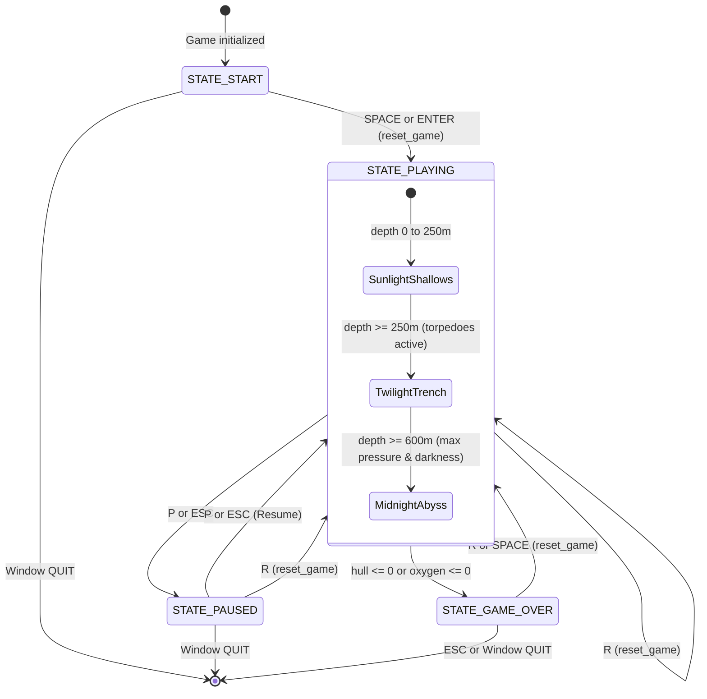
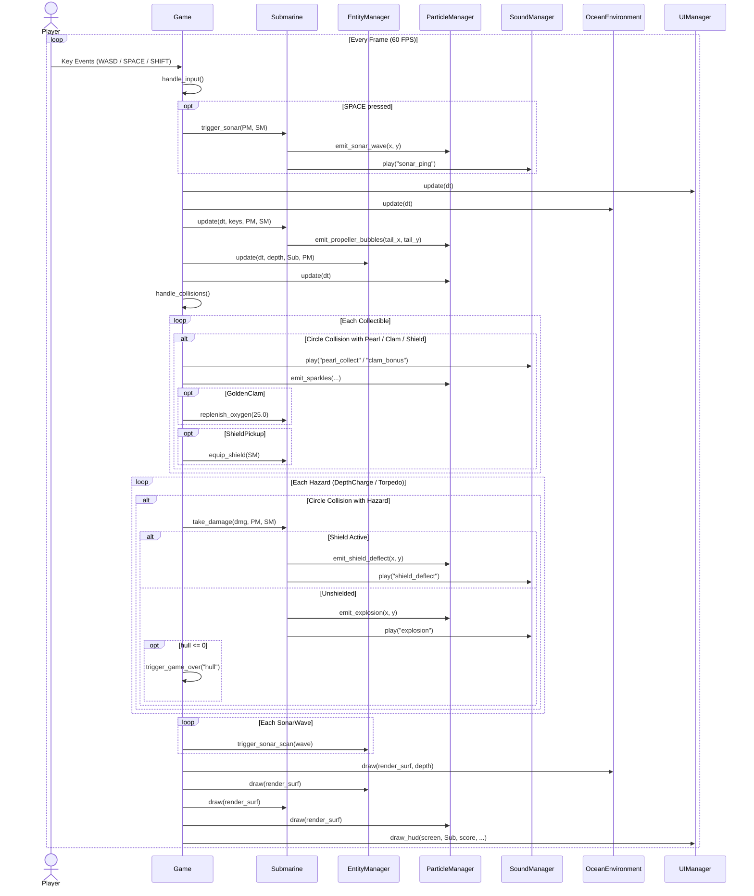
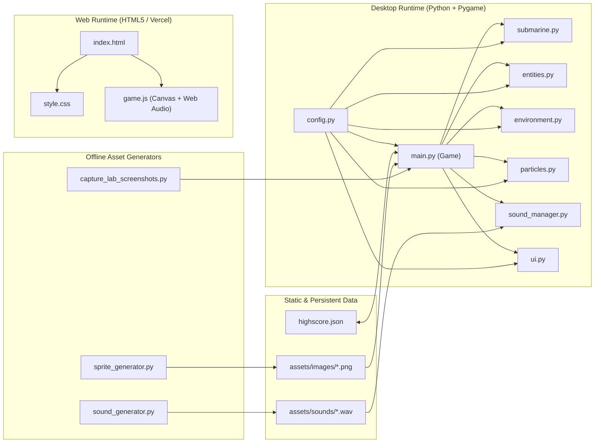

# UML Diagrams — Abyssal Expedition: Deep Sea Submarine

This document provides the complete UML specification of the **Abyssal Expedition: Deep Sea Submarine** project, derived directly from the Python/Pygame source code.

---

## 1. UML Class Diagram

Shows all classes, key attributes, methods, inheritance hierarchies, compositions, and inter-module dependencies across [main.py](main.py), [submarine.py](submarine.py), [entities.py](entities.py), [environment.py](environment.py), [particles.py](particles.py), [sound_manager.py](sound_manager.py), and [ui.py](ui.py).

```mermaid
classDiagram
    direction TB

    class Game {
        +Surface screen
        +Clock clock
        +bool running
        +str state
        +int score
        +int high_score
        +float depth
        +int combo
        +float combo_timer
        +int max_combo_streak
        +int pearls_collected
        +int clams_collected
        +str game_over_reason
        +bool is_new_high_score
        +float screen_shake_time
        +float screen_flash_alpha
        +dict sprites
        +run() void
        +reset_game() void
        +handle_input() void
        +update(dt) void
        +draw() void
        +handle_collisions() void
        +check_circle_collision(c1, c2) bool
        +trigger_game_over(reason) void
        -_load_sprites() dict
        -_load_high_score() int
        -_save_high_score() void
    }

    class Submarine {
        +float x
        +float y
        +float vx
        +float vy
        +float radius
        +float hull
        +float oxygen
        +bool has_shield
        +bool alive
        +float sonar_timer
        +bool is_boosting
        +float invulnerable_timer
        +float pitch_angle
        +float propeller_angle
        +reset(x, y) void
        +get_hitbox_circle() tuple
        +trigger_sonar(particle_mgr, sound_mgr) bool
        +equip_shield(sound_mgr) void
        +take_damage(amount, particle_mgr, sound_mgr) str
        +replenish_oxygen(amount) void
        +update(dt, keys, particle_mgr, sound_mgr) void
        +draw_headlight(surface) void
        +draw(surface) void
    }

    class EntityManager {
        +dict sprites
        +list collectibles
        +list hazards
        +list warnings
        +float pearl_spawn_timer
        +float mine_spawn_timer
        +float torpedo_spawn_timer
        +float clam_spawn_timer
        +float shield_spawn_timer
        +reset() void
        +trigger_sonar_scan(sonar_wave) void
        +update(dt, current_depth, player, particle_mgr) void
        +draw(surface) void
    }

    class Entity {
        +float x
        +float y
        +float radius
        +Surface sprite
        +bool alive
        +get_hitbox_circle() tuple
        +is_offscreen() bool
    }

    class Pearl {
        +float base_y
        +float speed_x
        +float phase
        +float amplitude
        +float frequency
        +bool is_magnetized
        +float glow_timer
        +update(dt, player) void
        +draw(surface) void
    }

    class GoldenClam {
        +float speed_x
        +float bob_phase
        +float sparkle_timer
        +update(dt, player, particle_mgr) void
        +draw(surface) void
    }

    class ShieldPickup {
        +float speed_x
        +float rot_angle
        +float bob_phase
        +update(dt, player) void
        +draw(surface) void
    }

    class DepthCharge {
        +float speed_y
        +float base_x
        +float swing_amplitude
        +float swing_speed
        +float swing_phase
        +float blink_timer
        +bool is_blinking
        +update(dt, player) void
        +draw(surface) void
    }

    class Torpedo {
        +float speed_x
        +float vy
        +float bubble_timer
        +update(dt, particle_mgr) void
        +draw(surface) void
    }

    class TorpedoWarning {
        +float y
        +float duration
        +float elapsed
        +bool ready_to_spawn
        +update(dt) bool
        +draw(surface) void
    }

    class OceanEnvironment {
        +float timer
        +list kelp_forest
        +list plankton_swarm
        +get_zone_colors(depth) tuple
        +update(dt) void
        +draw(surface, depth) void
        -_lerp_color(c1, c2, t) tuple
    }

    class KelpFrond {
        +float base_x
        +float base_y
        +int height
        +int segments
        +float phase
        +float speed
        +tuple color
        +draw(surface, time) void
    }

    class Plankton {
        +float x
        +float y
        +float vx
        +float vy
        +float phase
        +float blink_speed
        +update(dt) void
        +draw(surface, is_abyss) void
    }

    class ParticleManager {
        +list bubbles
        +list sparkles
        +list explosions
        +list shockwaves
        +list sonar_waves
        +emit_propeller_bubbles(x, y, is_boost) void
        +emit_sparkles(x, y, color, count) void
        +emit_explosion(x, y, count) void
        +emit_shield_deflect(x, y) void
        +emit_sonar_wave(x, y) void
        +update(dt) void
        +draw(surface) void
    }

    class Bubble {
        +float x
        +float y
        +float vx
        +float vy
        +float radius
        +float life
        +bool is_propeller
        +bool is_boost
        +update(dt) bool
        +draw(surface) void
    }

    class Sparkle {
        +float x
        +float y
        +float vx
        +float vy
        +tuple color
        +float life
        +float size
        +update(dt) bool
        +draw(surface) void
    }

    class ExplosionParticle {
        +float x
        +float y
        +float vx
        +float vy
        +float drag
        +float life
        +bool is_smoke
        +update(dt) bool
        +draw(surface) void
    }

    class Shockwave {
        +float x
        +float y
        +float radius
        +float max_radius
        +float duration
        +float elapsed
        +tuple color
        +update(dt) bool
        +draw(surface) void
    }

    class SonarWave {
        +float x
        +float y
        +float radius
        +float max_radius
        +float speed
        +bool active
        +update(dt) bool
        +draw(surface) void
    }

    class SoundManager {
        +str sounds_dir
        +dict sounds
        +bool muted
        +bool audio_available
        +load_all_sounds() void
        +play(sound_name) void
        +toggle_mute() bool
    }

    class UIManager {
        +Font font_title
        +Font font_subtitle
        +Font font_heading
        +Font font_body
        +Font font_hud
        +float blink_timer
        +update(dt) void
        +draw_hud(surface, player, score, high_score, depth, combo, combo_timer, max_combo_time) void
        +draw_start_screen(surface, high_score) void
        +draw_pause_screen(surface) void
        +draw_game_over_screen(surface, reason, score, high_score, depth, pearls, clams, max_combo, is_new_record) void
    }

    %% Core Composition from Game
    Game *-- "1" Submarine : controls
    Game *-- "1" EntityManager : manages
    Game *-- "1" OceanEnvironment : renders
    Game *-- "1" ParticleManager : emits
    Game *-- "1" SoundManager : plays audio
    Game *-- "1" UIManager : displays HUD

    %% Entity Inheritance & Composition
    Entity <|-- Pearl
    Entity <|-- GoldenClam
    Entity <|-- ShieldPickup
    Entity <|-- DepthCharge
    Entity <|-- Torpedo

    EntityManager *-- "0..*" Entity : collectibles & hazards
    EntityManager *-- "0..*" TorpedoWarning : warnings
    TorpedoWarning ..> Torpedo : spawns

    %% Environment Composition
    OceanEnvironment *-- "1..*" KelpFrond : kelp_forest
    OceanEnvironment *-- "35" Plankton : plankton_swarm

    %% Particle Composition
    ParticleManager *-- "0..*" Bubble
    ParticleManager *-- "0..*" Sparkle
    ParticleManager *-- "0..*" ExplosionParticle
    ParticleManager *-- "0..*" Shockwave
    ParticleManager *-- "0..*" SonarWave

    %% Runtime Dependencies
    Submarine ..> ParticleManager : emits wake & sonar
    Submarine ..> SoundManager : plays SFX
    EntityManager ..> Submarine : tracks position
    EntityManager ..> ParticleManager : emits sparkles & wake
    EntityManager ..> SonarWave : magnetizes pearls
    UIManager ..> Submarine : reads hull/oxygen/shield
```

---

## 2. UML State Machine Diagram

Illustrates the game's finite state machine implemented in [main.py](main.py) and driven by `handle_input()`, `update()`, and `trigger_game_over()`.

---

## 3. UML Sequence Diagram (60 FPS Frame Loop & Interactions)

Details the per-frame execution flow during `STATE_PLAYING`, including user input, Sonar Ping magnetization, circle-circle collision resolution, and layered rendering.

---

## 4. UML Component & Module Architecture Diagram

Shows how the Python runtime modules, offline asset generators, persistent files, and the standalone HTML5/Vercel web port relate to one another.

